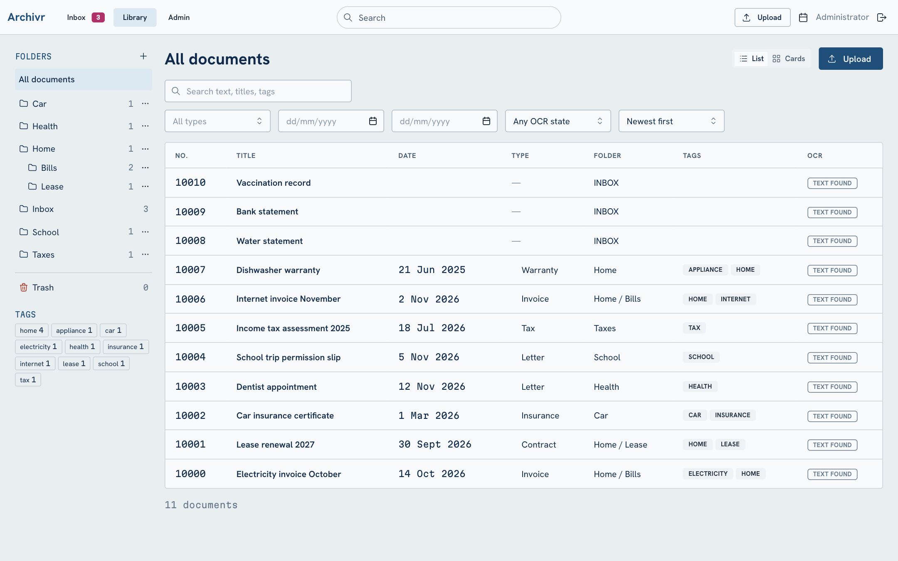
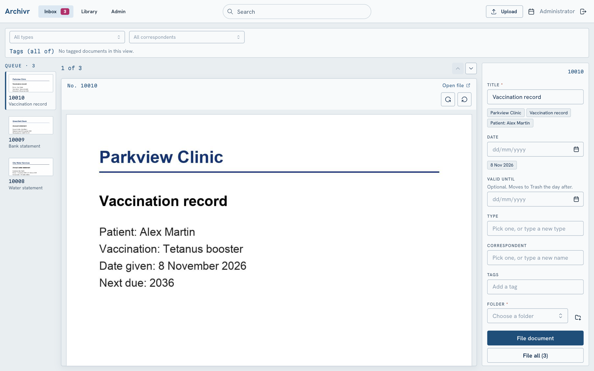
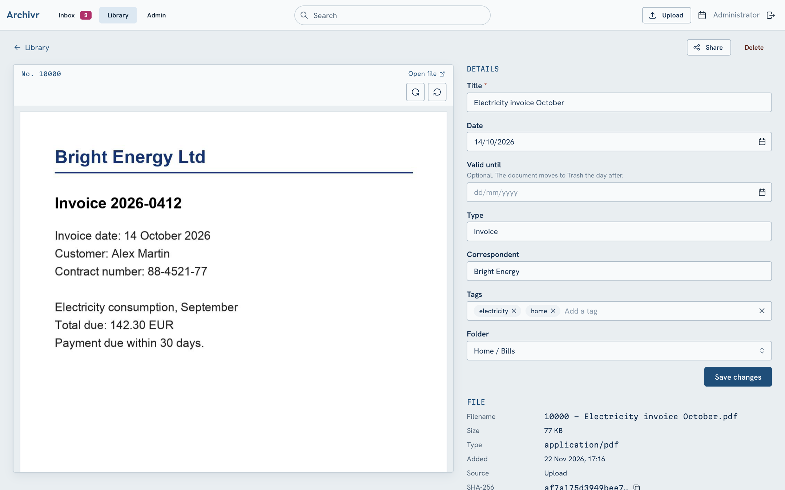
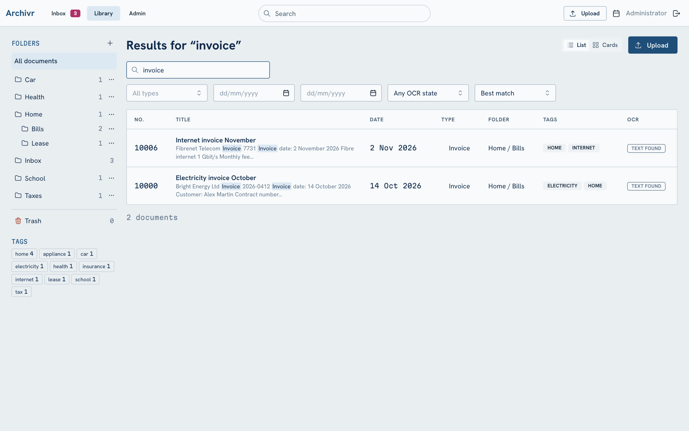
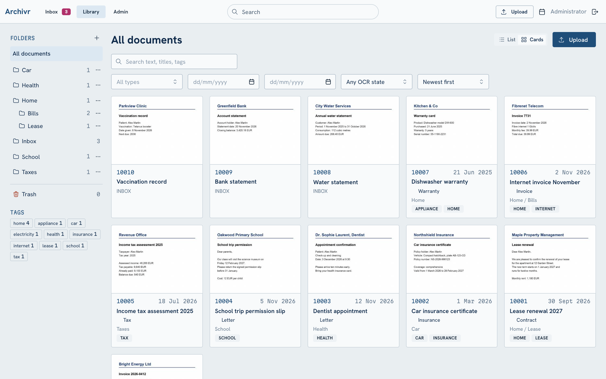

# Archivr

A self-hosted archive for your scanned paper and PDFs.

Documents arrive from a scanner folder, by email, or by upload. Each one gets a number, is read with OCR so you can search its text, and is filed into folders you choose. Every file is also kept on disk in a plain folder tree, so your archive stays usable without Archivr.



## Features

- **Several ways in.** Drop files in a watch folder (a scanner or a sync tool), send them as email attachments, upload them in the browser, or import a whole [Paperless-ngx](#importing-from-paperless-ngx) library.
- **Inbox for sorting.** New documents wait in the Inbox. Go through them one at a time, fill in the title, date, type, correspondent, tags and folder, and file them. Archivr suggests dates and titles it finds in the text. Keyboard shortcuts keep it fast, and **File all** handles the ticked ones in one go.
- **Full-text search.** Search the text of every document, as well as titles, tags and correspondents. Accents and ligatures are ignored, words match from their start, and results show where the words were found. Press `Ctrl/⌘ K` anywhere to search.
- **Text recognition.** Scans and photos are read with Tesseract, English and French by default, and PDFs with a text layer are used as they are. Languages and time limits are set in the Admin screen.
- **Folders, types, tags.** Organise by folder, then narrow by type, tag, date range or recognition state. Switch between a list and a card view with page previews.
- **Previews you can fix.** Open any document in the browser and turn it if it was scanned sideways. The file itself is never changed.
- **Expiry dates.** Give a document a "valid until" date, such as an insurance certificate. The day after, it moves to Trash.
- **Trash.** Deleted documents go to Trash first. Restore them, or delete them for good from there.
- **Share links.** Send one document to someone without an account, using a link that expires when you choose, from one minute to a year.
- **Several users.** Local accounts, or single sign-on with any OpenID Connect provider. Admins manage accounts, mail intake, document types and imports.
- **Plain files on disk.** Documents are stored as `10001 - Lease renewal.pdf` in folders that mirror your own, each with a small sidecar file holding its metadata.
- **Backups.** Optional continuous replication of the database with Litestream.

## Screenshots

### Sorting the inbox



### Reading a document and editing its details



### Searching the text of your documents



### Card view



## Getting started

The easiest way to run Archivr is the Docker image. It includes Tesseract (English and French) and Poppler.

```sh
docker build -t archivr .
docker run -p 8080:8080 -v archivr-data:/data \
  -e PUBLIC_URL=http://localhost:8080 -e INIT_PASSWORD=change-me \
  archivr
```

Open http://localhost:8080 and sign in with `admin@archivr.local` and the password you set in `INIT_PASSWORD`.

Then remove `INIT_PASSWORD` from the container's settings. While it is set, it resets that account's password and role on every start.

`deploy/k8s/archivr.yaml` is a Kubernetes example with a Traefik route. Replace the placeholders before applying it.

To build or change Archivr itself, see [DEVELOPER.md](DEVELOPER.md).

### First steps

1. Put a few files in the watch folder (`ingest/` inside the data directory), or press **Upload**.
2. Open **Inbox**, give each document a title and a folder, and file it.
3. In **Admin**, set up what you need: mail intake, single sign-on, text recognition languages, document types, and more accounts.

## Configuration

| Variable | Default | Purpose |
| --- | --- | --- |
| `LISTEN_ADDR` | `:8080` | Address the server listens on. |
| `PUBLIC_URL` | derived from the request | External address, for the SSO callback and links. When unset, derived from the request, using `X-Forwarded-Host` and `X-Forwarded-Proto` if `TRUST_PROXY` is set. |
| `DATA_DIR` | `./data` | Holds `archivr.db`, `documents/`, `trash/`, `cache/`, and `ingest/` by default. |
| `WATCH_DIR` | `DATA_DIR/ingest` | Folder polled for new files. Imported files move to `.imported/`, rejects to `.rejected/`. |
| `OIDC_LOGOUT_URL` | from the provider's discovery document | Provider logout endpoint used when signing out with SSO. Set it when the provider does not advertise `end_session_endpoint`, or to use a different one. When set, sign-out skips discovery. |
| `TRUST_PROXY` | off | Set behind a proxy you control, to the number of proxies in front of Archivr: `1` for Traefik alone, `2` for a CDN in front of Traefik. Any value that is not a number means `1`. Reads `X-Forwarded-For`, `X-Forwarded-Host` and `X-Forwarded-Proto`. The client address is the `X-Forwarded-For` entry the outermost proxy added. Too high a number lets clients choose their address and get around sign-in limits. |
| `JWT_SECRET` | random per run | Signs session cookies and share links. Set it, or everyone is signed out and every share link stops working on restart. |
| `INIT_ADMIN_EMAIL` | `admin@archivr.local` | The first admin account. |
| `INIT_PASSWORD` | unset | Bootstrap password. **Applied on every start while set.** It resets that account's password and role, so remove it once you can sign in. |
| `DEBUG` | off | Verbose logging. |
| `DB_PATH` | `DATA_DIR/archivr.db` | Location of the SQLite file. Set by the container when Litestream is enabled. |
| `LITESTREAM_REPLICA_URL` | unset | Enables continuous replication with Litestream, for example `s3://bucket/archivr`. See below. |

Mail intake (IMAP) and sign-in (OIDC) are configured in **Admin** after first start, not in environment variables. OCR languages and time limits are configured there too.

### Single sign-on

In **Admin → Sign-in**, enter the issuer, client ID and secret, and register the callback URL shown on that screen with your identity provider.

- The role is set from the `groups` claim on **every** SSO sign-in. Members of the configured admin group get `admin`, everyone else gets `user`. Set the admin group before the first SSO sign-in, or an admin who signs in through SSO is demoted.
- **Disable local login** is only allowed while SSO is configured. Turn it on once SSO works, so you cannot lock yourself out.

### Importing from Paperless-ngx

In **Admin → Paperless**, enter the address of your Paperless-ngx server and an API token (Paperless → My Profile), press **Test connection**, then **Start import**. The import runs in the background and the screen shows progress.

- Each document keeps its title, date, document type, correspondent, and tags. Document types that do not exist yet are created. The Paperless correspondent goes into the document's correspondent field.
- Documents go to INBOX, or to a folder you pick.
- **File by tag.** Before starting, you can map Paperless tags to Archivr folders, so documents are filed directly instead of landing in INBOX. The rules are ordered: a document goes to the folder of the first rule whose tag it carries, and a document that matches no rule goes to the folder chosen above. Tags match without regard to case. Folders must already exist. Press **Get tag lists** to read the tags from Paperless: every tag appears with its document count and a folder picker, with a filter and an "only unmapped" switch. Folders can be made on this screen without leaving it, using **New folder**. The rules are saved, and starting an import saves them first.
- The rules also apply to documents that are already in the archive, whether an earlier run imported them or the same file is there under another name, but only to those still waiting in INBOX: a document that matches a rule is filed in that folder. A document that already has a folder, whether a rule or you put it there, is never moved, and neither is one that matches no rule. The result screen counts how many documents were filed this way. This makes the rules a way to sort out an earlier import that is still in INBOX: set them, then run the import again.
- The original file is imported. When Archivr cannot read the original (a Word file, for example) the PDF that Paperless made of it is used.
- Archivr reads every file again with its own text recognition. The text Paperless extracted is not copied over.
- Running it again only adds what is new. Documents already imported are skipped without being downloaded again, and a document whose bytes already exist in Archivr is reported as a duplicate.
- Nothing is changed in Paperless. The token only needs to read documents.
- A server with a self-signed or internal certificate needs **Ignore SSL certificate errors**. It is off by default, and with it on the certificate is not checked at all, so use it only on a network you trust. Adding your certificate authority to the system trust store is the safer fix.

### Replicating the database with Litestream

The image includes [Litestream](https://litestream.io). It is off unless `LITESTREAM_REPLICA_URL` is set. Without it, the database stays in `DATA_DIR` and nothing changes.

- With it, the database runs from the container's local disk at `/tmp/archivr.db` (`ARCHIVR_LOCAL_DB` changes this). It is not under `DATA_DIR`, so SQLite never writes its WAL to a network volume. Documents, the ingest folder, and the rest stay in `DATA_DIR`.
- On every start, the database is restored from the newest replica. Litestream then streams every change while Archivr runs. Litestream runs Archivr as its child process and forwards shutdown signals, so `docker stop` and pod termination stop both cleanly.
- If there is no replica yet but `DATA_DIR/archivr.db` exists, the container refuses to start. Starting would create an empty database beside the real documents. To enable replication on an existing archive, copy the database to the local path, then run `litestream replicate -once` with the same config so the first snapshot is written before the first start.
- Run exactly one container per replica, including during upgrades. Two Litestream processes writing the same replica corrupt it, and every later restore inherits the damage. On Kubernetes, use a StatefulSet (as in `deploy/k8s/archivr.yaml`) or a Deployment with `strategy: Recreate`. The default `RollingUpdate` starts the new pod before it stops the old one.
- For S3, set `AWS_ACCESS_KEY_ID`, `AWS_SECRET_ACCESS_KEY`, and `AWS_REGION` when your provider needs it. For a local folder, use `file:///path/to/replica`.
- Replication covers the database only. Keep the `documents/` folder backed up as well. Files written after the last replicated change can exist without a database row. Their sidecars still hold the metadata.

## Where the files live

```
DATA_DIR/
  archivr.db                     index, metadata, search
  documents/
    INBOX/10000 - Landlord letter.pdf
    Home/Lease/10001 - Lease renewal.pdf
  cache/thumbs/                  preview images, named by content hash
  ingest/                        watch folder
```

Each document also has a small `….archivr.json` sidecar beside it with its number, title, date, type, tags and checksum. The sidecars keep the metadata next to the files, but no tool rebuilds the database from them yet.

Document numbers start at 10000 and are never reused.

## Known limits

- **Deleting a document files it in Trash.** Open Trash, at the bottom of the folder list, to restore it or delete it for good. Deleting it from Trash removes the file and its sidecar. That step cannot be undone.
- HEIC photos are rejected with a message. Convert them to JPEG or PNG first.
- Email intake reads unread messages only. Mail is marked read after its attachments are filed.
- Files over 100 MB are refused.
- One server process per data directory. SQLite and the file tree are not shared between instances.
- The Docker image includes Tesseract (English and French) and Poppler. Outside the container, without Tesseract, documents are marked OCR `skipped`, and without Poppler, PDFs get no text and no preview. **Admin → Text recognition** says what is missing, and **Run OCR again** fixes skipped documents once the tools are installed.

## For developers

Building from source, running the tests and the design notes are in [DEVELOPER.md](DEVELOPER.md).
